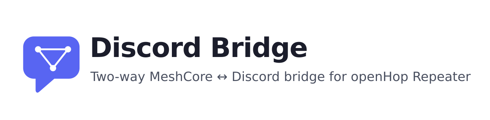

<picture>
  <source media="(prefers-color-scheme: dark)" srcset="branding/lockup-dark.svg">
  
</picture>

# openHop Discord Bridge

Two-way bridge between **MeshCore channels** and **Discord channels**, packaged as
an [openHop Repeater](https://github.com/openhop) plugin.

Mesh senders appear in Discord as themselves (posted through a webhook, not the
bot account). Discord messages in a mapped channel are transmitted onto the mesh
through the bridge's **own dedicated companion identity**, with an explicit
allowlist deciding who may transmit.

```
 mesh channel ──► repeater.db packets (type=5, AES-128-ECB)
                        │  tail by id, decrypt per channel secret
                        ▼
                 bridge process ──────────────► Discord webhook
                 (on the repeater host)  username = mesh sender
                        ▲                             │
                        │ CMD_SEND_CHANNEL_TXT_MSG    │ message in mapped channel
                        └─────────────────────────────┘
                   companion TCP :5003          (bot ignores its own webhooks)
```

## Why a dedicated companion

The Repeater's REST API has no channel-chat endpoint and no way to send a group
text. Channel history has to come out of the node's SQLite `packets` table
(`type=5` GRP_TXT, decryptable with the channel secret), and transmitting has to
ride the companion protocol. Sharing an existing companion (`Hermes`, `Home
Assistant`, a base station) splits acks and events between two clients and makes
attribution ambiguous, so the bridge gets its own identity, its own port and its
own channel list.

## How it works

| Direction | Mechanism |
| --- | --- |
| mesh -> Discord | Read-only `packets` tail (`mode=ro`), HMAC-validated AES-128-ECB decrypt, dedupe on `(device timestamp, text)`, post via webhook with `username` = sender |
| Discord -> mesh | `CMD_SEND_CHANNEL_TXT_MSG` over the companion TCP socket, prefixed with the author, truncated to the mesh byte budget |

Channel provisioning rides `CMD_SET_CHANNEL`, which the node persists itself — the
bridge never edits `config.json` or the database, so **no repeater restart** is
needed to add or re-index its channels.

### Loop and abuse guards

- Webhook posts are ignored on intake (`webhook_id` set), so mesh traffic cannot
  bounce back through Discord.
- Every transmitted payload is remembered for `echo_ttl_seconds`, so the bridge's
  own transmission arriving back through the packet log is dropped.
- `(device_timestamp, text)` dedupe: each group text is logged once per hop,
  otherwise every message would appear ~4x.
- A per-channel token bucket throttles Discord -> mesh: a Discord argument must
  not become a sustained LoRa flood.
- `allowed_user_ids` / `allowed_role_ids` gate transmission. **Empty means
  nobody** — bridging a Discord channel onto RF is never an implicit grant.

## Install

```bash
# On the repeater host, create the companion identity first (its own port):
#   POST /api/create_identity  {"name":"Discord Bridge","type":"companion",
#     "settings":{"node_name":"Discord Bridge","tcp_port":5003,"bind_address":"127.0.0.1"}}

python -m build --wheel
# then install the wheel through the plugin manager:
#   POST /api/plugins/install {"wheel_path":"/tmp/openhop_discord_bridge-0.1.0-py3-none-any.whl"}
#   POST /api/plugins/settings {"id":"discord.bridge","config":{...}}
#   POST /api/plugins/enable   {"id":"discord.bridge"}
```

A fresh companion starts with no channels; the bridge provisions them from the
repeater database at startup, so only the identity needs creating by hand.

## Configuration

`$OPENHOP_PLUGIN_DATA/config.json` (the bot token may instead come from
`DISCORD_BOT_TOKEN`, which keeps it out of files that get shared):

```json
{
  "discord_token": "",
  "companion_host": "127.0.0.1",
  "companion_port": 5003,
  "repeater_db_path": "/var/lib/openhop_repeater/repeater.db",
  "max_mesh_bytes": 128,
  "mesh_prefix_template": "[{author}] ",
  "rate_capacity": 3,
  "rate_refill_seconds": 12.0,
  "echo_ttl_seconds": 120,
  "channels": [
    {
      "mesh_channel": "Public",
      "discord_channel_id": 1489064468154417172,
      "mesh_to_discord": true,
      "discord_to_mesh": true,
      "allowed_role_ids": [783623771440676905]
    }
  ]
}
```

Unmapped channels are ignored in both directions. `mesh_to_discord` and
`discord_to_mesh` are independent, so a channel can be mirrored read-only.

## Discord setup

1. New application + bot (**not** an existing assistant bot), enable the
   **Message Content** intent.
2. Invite it with View Channels, Read Message History, Manage Webhooks.
3. Map each mesh channel to a Discord channel by ID.

## Development

```bash
python -m venv .venv && .venv/bin/pip install -e ".[dev]"
.venv/bin/python -m pytest -q
```

## Limitations

- Group text carries no sender public key; the `Name: body` prefix is
  self-reported, so mirrored messages are unauthenticated.
- Mesh has no attachments, edits or reactions — Discord-only concepts are dropped
  (an attachment-only message becomes `[attachment]`).
- A message longer than the byte budget is truncated on a word boundary with `…`.

## Branding

| File | Use |
| --- | --- |
| `branding/logo.svg` | primary mark — vector, works on light and dark |
| `branding/logo-512.png` / `-128.png` / `-64.png` | Discord avatar, plugin icon, favicon |
| `branding/lockup-light.svg` / `lockup-dark.svg` | README header, light and dark themes |

The mark is a chat bubble carrying a mesh constellation: the silhouette reads
as Discord at any size, the nodes read as a mesh. Ink bounding box is centred to
within a pixel of the canvas, and nothing in the mark depends on the background
colour, so it survives both themes.


## Licence

MIT
